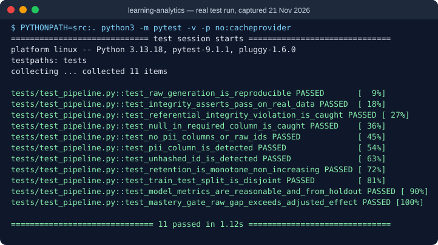

# Learning Analytics — reproducible pipeline, honest model — manual

*One page, eight blocks. Every figure here comes from this repository's own tests and README.*

## 1. Claim
The mastery gate's raw 31% → 69% completion gap is confounded by prior ability. A held-out model (AUC ≈ 0.76) shows that, and a test keeps the claim honest.

## 2. What it is
A reproducible analysis of (synthetic, anonymised) learning data: what predicts completion, how retention decays, and what the mastery gate is really worth. The same numbers feed a Streamlit dashboard, a Power BI model and an Excel what-if model.

## 3. Demo
Streamlit dashboard: `make dashboard`. Figures in `figures/`; method and limits in `WRITEUP.md`.


*Real output from this repository's own tests, captured 21 Nov 2026.*

## 4. Run it yourself
**Prerequisites:** Python 3 and make.

```bash
make all
make test
make dashboard
```

## 5. What you will see
11 tests pass, covering byte-identical regeneration, integrity asserts, no PII and no leakage. The dashboard shows the same figures as `figures/`.

## 6. 30-second talking point
> The easy headline was a 38-point jump from the mastery gate. The honest one is that prior ability explains a comparable share. I would rather show a stakeholder the confounder than sell them the headline.

## 7. Scope and limits
- The data is synthetic. The method is the deliverable; effect sizes must be re-measured on real data.

## 8. Links
[Repository](https://github.com/fhionnghaile/learning-analytics) · [Write-up](https://padraigfhionnghaile.com/work/learning-analytics/) · [README](README.md)
